  

<h1 align="center">Amey Pawar</h1>

  Software Engineer · Observability &amp; Version Control 
  <a href="https://github.com/search?type=pullrequests&q=is%3Apr%20is%3Amerged%20author%3Aameyypawar%20-user%3Aameyypawar%20-org%3Avoss-labs%20-repo%3Adevdattatalele%2FVFORUM">68 merged open-source PRs</a>, including 25 in <a href="https://github.com/openobserve/openobserve">OpenObserve</a> and 24 in <a href="https://github.com/GitoxideLabs/gitoxide">gitoxide</a> · Rust &amp; TypeScript 
  Final-year BTech, graduating May 2027 · Open to new-grad roles, internships and contract work

 

  
  
  
  
  
  

